# Memory Lane — Database Design

Date: 2026-11-17
Stage: Stage 1 — Discovery and System Design, Prompt 04
Design only — no database, migrations, or code exist or were changed.

Implements the data layer of [SYSTEM_ARCHITECTURE.md](SYSTEM_ARCHITECTURE.md)
(Section 4) and [DECISIONS.md](DECISIONS.md) (ADR-002, ADR-008).
API usage of these entities: [API_SPECIFICATION.md](API_SPECIFICATION.md).
Who may read/write each entity: [PERMISSIONS_MATRIX.md](PERMISSIONS_MATRIX.md).

> Input note: Prompt 02 deliverables are still absent from the repo. Entity
> coverage follows the project brief's modules A–H and the Prompt 03 module
> list. Reconcile with Prompt 02 when it is backfilled.

## 1. Global conventions

- **Engine:** PostgreSQL 16+. Access via SQLAlchemy 2.x async; migrations
  via Alembic, one chain, reviewed for production safety.
- **Keys:** `id UUIDv7 PRIMARY KEY` everywhere (time-ordered,
  index-friendly). One exception: append-only high-rate rows may add a
  `BIGINT GENERATED ALWAYS AS IDENTITY` sequence for ordering but keep a UUID PK.
- **UUIDv7 generation (implementation note):** ids are generated app-side
  (`app/models/uuid7.py`), not via a `DEFAULT uuidv7()` clause, because
  PostgreSQL 16 has no `uuidv7()` builtin. This also lets handlers return
  ids before insert (useful for idempotency).
- **Timestamps:** `created_at TIMESTAMPTZ NOT NULL DEFAULT now()`,
  `updated_at TIMESTAMPTZ NOT NULL DEFAULT now()` (trigger-maintained) on
  every table.
- **Soft delete:** user-visible content tables carry
  `deleted_at TIMESTAMPTZ NULL`; queries filter `deleted_at IS NULL` by
  default (repository helper, tested). Hard delete happens only through the
  privacy/deletion flow (archives module) or explicit owner purge.
- **Money:** `amount_minor BIGINT` + `currency CHAR(3)`; never floats.
- **Timezones:** all stored times UTC; originating IANA zone kept alongside
  where date math is zone-sensitive (`scheduled_events.run_at` + `timezone`).
- **Enums:** Postgres native enums for stable sets (role, status, kind);
  new values only via migration. Open-ended sets (occasion types, reaction
  emoji) are `TEXT` with `CHECK` or lookup tables.
- **Idempotency:** every row created by a retried operation carries a caller-
  or system-supplied idempotency key with a `UNIQUE` constraint; workers use
  `INSERT … ON CONFLICT DO NOTHING` + re-read.
- **No RLS:** one service role; authorization enforced in the `permissions`
  module (ADR-006). DB `CHECK`/`FK` constraints enforce integrity, not policy.

## 2. Entity relationship overview

```mermaid
erDiagram
    users ||--o{ user_sessions : "has"
    users ||--o{ space_memberships : "joins"
    users ||--o{ contributions : "authors (nullable)"
    users ||--o{ subscriptions : "holds"
    users ||--o{ notifications : "receives"
    users ||--o{ usage_records : "accrues"

    spaces ||--o{ space_memberships : "grants"
    spaces ||--o{ guest_access_tokens : "issues"
    spaces ||--o{ invitations : "sends"
    spaces ||--o{ contributions : "collects"
    spaces ||--|| space_settings : "configures"
    spaces }o--|| themes : "uses"
    spaces ||--o{ scheduled_events : "schedules"
    spaces ||--o{ ai_generation_jobs : "runs"
    spaces ||--o{ archives : "exports"
    spaces ||--o{ moderation_records : "queues"

    contributions ||--o{ contribution_attachments : "carries"
    contributions ||--o{ reactions : "receives"
    contributions ||--o{ replies : "receives"
    media_assets ||--o{ contribution_attachments : "attached-as"
    media_assets ||--o{ media_processing_jobs : "processed-by"
    ai_generation_jobs ||--o{ ai_generated_assets : "produces"
    subscriptions ||--o{ payments : "billed-by"
```

## 3. Identity and users

### 3.1 `users`

Account holder (owner / collaborator / identified contributor / admin).
Guests without accounts never appear here.

| Field | Type | Constraints |
|---|---|---|
| id | UUIDv7 PK | |
| email | CITEXT | `UNIQUE NOT NULL` (case-insensitive) |
| display_name | TEXT | `NOT NULL`, 1–80 chars (app-validated) |
| avatar_asset_id | UUID NULL | FK → `media_assets.id ON DELETE SET NULL` |
| role_global | ENUM `('user','admin')` | `NOT NULL DEFAULT 'user'` |
| email_verified_at | TIMESTAMPTZ NULL | set on first successful OTP/magic verify |
| locale | TEXT | `NOT NULL DEFAULT 'en'`, BCP-47 |
| timezone | TEXT | IANA name, default `Africa/Lagos` |
| marketing_opt_in | BOOLEAN | `NOT NULL DEFAULT false` |
| deleted_at | TIMESTAMPTZ NULL | soft delete; purge flow hard-deletes |

Indexes: `users(email)` unique; `users(created_at)`.
Ownership: row owned by the user; admins read for support.
Deletion: soft-delete on account close; purge job hard-deletes after grace
and detaches content per Section 12 (contributions keep, author → tombstone).

### 3.2 `user_sessions`

One row per login session (passwordless). Refresh rotation via token hash chain.

| Field | Type | Constraints |
|---|---|---|
| id | UUIDv7 PK | |
| user_id | UUID | `NOT NULL`, FK → `users.id ON DELETE CASCADE` |
| refresh_hash | TEXT | `NOT NULL UNIQUE` (sha256 of refresh token) |
| device_label | TEXT NULL | user-agent derived, 200 chars max |
| ip_created | INET NULL | |
| expires_at | TIMESTAMPTZ | `NOT NULL` |
| revoked_at | TIMESTAMPTZ NULL | logout / logout-everywhere sets this |
| last_seen_at | TIMESTAMPTZ | `NOT NULL DEFAULT now()` |

Indexes: `user_sessions(user_id, revoked_at)`; unique `refresh_hash`.
Ownership: user. Deletion: cascade with user; janitor deletes expired+revoked.

### 3.3 `otp_challenges` (supporting; Redis-backed but DB-audited)

Short-lived; hot path lives in Redis, but each issue/verify writes an audit row.

| Field | Type | Constraints |
|---|---|---|
| id | UUIDv7 PK | |
| email | CITEXT | `NOT NULL` |
| code_hash | TEXT | `NOT NULL` (sha256, single-use) |
| magic_hash | TEXT | `NOT NULL UNIQUE` (sha256 of magic token) |
| attempts | SMALLINT | `NOT NULL DEFAULT 0`, max 5 then invalidate |
| expires_at | TIMESTAMPTZ | `NOT NULL`, TTL 10 min |
| consumed_at | TIMESTAMPTZ NULL | verify sets; both paths consume both secrets |
| ip_request | INET NULL | abuse auditing |

Indexes: unique `magic_hash`; `(email, expires_at)`.
Deletion: janitor hard-deletes expired rows hourly. No FK to users (unknown
emails must leave identical traces — no account oracle).

## 4. Spaces, membership, and guest access

### 4.1 `spaces`

A memory space (shared or personal). Central aggregate root.

| Field | Type | Constraints |
|---|---|---|
| id | UUIDv7 PK | |
| owner_id | UUID | `NOT NULL`, FK → `users.id ON DELETE RESTRICT` (transfer or purge first) |
| title | TEXT | `NOT NULL`, 1–120 chars |
| description | TEXT NULL | max 2000 chars |
| occasion | TEXT | `NOT NULL` (birthday, wedding, graduation, anniversary, farewell, tribute, family, travel, baby, journal, community, capsule, other) |
| theme_id | UUID | `NOT NULL`, FK → `themes.id ON DELETE RESTRICT` |
| visibility | ENUM `('private','link','scheduled')` | `NOT NULL DEFAULT 'private'` |
| contribution_policy | ENUM `('owner_only','members','link_contributors','anyone_with_link')` | `NOT NULL DEFAULT 'link_contributors'` |
| moderation_mode | ENUM `('post','pre')` | `NOT NULL DEFAULT 'post'` |
| allow_anonymous | BOOLEAN | `NOT NULL DEFAULT true` |
| allow_viewer_react | BOOLEAN | `NOT NULL DEFAULT false` |
| ai_opt_in | BOOLEAN | `NOT NULL DEFAULT false` (explicit opt-in, ADR-007) |
| event_date | DATE NULL | the occasion date (birthdays, weddings…) |
| publish_at | TIMESTAMPTZ NULL | scheduled reveal; NULL = already visible |
| location_label | TEXT NULL | free text, 200 chars |
| cover_asset_id | UUID NULL | FK → `media_assets.id ON DELETE SET NULL` |
| storage_quota_bytes | BIGINT | `NOT NULL` (resolved from plan at creation; refreshed on plan change) |
| storage_used_bytes | BIGINT | `NOT NULL DEFAULT 0` (maintained transactionally) |
| deleted_at | TIMESTAMPTZ NULL | soft delete; purge removes all children |

Indexes: `spaces(owner_id, created_at)`; `spaces(publish_at)` partial
`WHERE publish_at IS NOT NULL AND deleted_at IS NULL`; `spaces(occasion)`.
Ownership: owner. Deletion: soft-delete cascades logically (space hidden with
all children); purge job hard-deletes children then space + bytes.

### 4.2 `space_memberships`

Logged-in members: collaborators (and identified contributors/viewers who
later create accounts and link).

| Field | Type | Constraints |
|---|---|---|
| id | UUIDv7 PK | |
| space_id | UUID | `NOT NULL`, FK → `spaces.id ON DELETE CASCADE` |
| user_id | UUID | `NOT NULL`, FK → `users.id ON DELETE CASCADE` |
| role | ENUM `('collaborator','contributor','viewer')` | `NOT NULL` |
| invited_by | UUID NULL | FK → `users.id ON DELETE SET NULL` |
| created_at / updated_at | | (no soft delete; delete row to remove) |

Constraints: `UNIQUE(space_id, user_id)`.
Indexes: `space_memberships(user_id)` for dashboard listing.
Deletion: row delete on remove/leave; contributions by the user stay (author
tombstoned only if the user is purged).

### 4.3 `guest_access_tokens`

Unguessable tokens embedded in share links / QR. The core of account-less access.

| Field | Type | Constraints |
|---|---|---|
| id | UUIDv7 PK | |
| space_id | UUID | `NOT NULL`, FK → `spaces.id ON DELETE CASCADE` |
| token_hash | TEXT | `NOT NULL UNIQUE` (sha256 of the 256-bit token; raw token shown once) |
| label | TEXT | `NOT NULL` (e.g. "WhatsApp group", "Printed QR") |
| role_cap | ENUM `('viewer','contributor')` | `NOT NULL DEFAULT 'contributor'` |
| max_uses | INT NULL | NULL = unlimited; counted in `use_count` |
| use_count | INT | `NOT NULL DEFAULT 0` |
| expires_at | TIMESTAMPTZ NULL | NULL = no expiry |
| revoked_at | TIMESTAMPTZ NULL | revocation is instant |
| created_by | UUID NULL | FK → `users.id ON DELETE SET NULL` |
| created_by_email | CITEXT NULL | snapshot for audit after user purge |

Indexes: unique `token_hash`; `guest_access_tokens(space_id, revoked_at)`.
Deletion: cascade with space; revoke (not delete) for auditability.

### 4.4 `invitations`

Email invitations to join as collaborator/contributor/viewer (for people
expected to create accounts).

| Field | Type | Constraints |
|---|---|---|
| id | UUIDv7 PK | |
| space_id | UUID | `NOT NULL`, FK → `spaces.id ON DELETE CASCADE` |
| email | CITEXT | `NOT NULL` |
| role | ENUM `('collaborator','contributor','viewer')` | `NOT NULL` |
| token_hash | TEXT | `NOT NULL UNIQUE` (single-use accept token) |
| invited_by | UUID NULL | FK → `users.id ON DELETE SET NULL` |
| accepted_at | TIMESTAMPTZ NULL | set on accept (creates membership) |
| expires_at | TIMESTAMPTZ | `NOT NULL`, default +14 days |
| revoked_at | TIMESTAMPTZ NULL | |

Constraints: `UNIQUE(space_id, email)` partial `WHERE accepted_at IS NULL
AND revoked_at IS NULL` (one pending invite per email per space).
Deletion: cascade with space; accepted rows retained as audit.

### 4.5 `themes`

Occasion-suitable layouts/themes. Seeded catalog + future custom themes.

| Field | Type | Constraints |
|---|---|---|
| id | UUIDv7 PK | |
| slug | TEXT | `NOT NULL UNIQUE` (e.g. `birthday-confetti`) |
| name | TEXT | `NOT NULL` |
| occasions | TEXT[] | `NOT NULL DEFAULT '{}'` (suggested occasions) |
| tokens | JSONB | `NOT NULL` (CSS variables, fonts, layout hints; schema-validated) |
| plan_required | ENUM `('free','premium')` | `NOT NULL DEFAULT 'free'` |
| is_active | BOOLEAN | `NOT NULL DEFAULT true` |

Deletion: `RESTRICT` — a theme in use cannot be deleted; deactivate instead.

### 4.6 `space_settings`

1:1 extension of `spaces` for notification/scheduling knobs (keeps `spaces` narrow).

| Field | Type | Constraints |
|---|---|---|
| space_id | UUID PK | FK → `spaces.id ON DELETE CASCADE` |
| reminder_enabled | BOOLEAN | `NOT NULL DEFAULT true` |
| reminder_days_before | INT[] | `NOT NULL DEFAULT '{7,1}'` |
| digest_enabled | BOOLEAN | `NOT NULL DEFAULT true` (On This Day etc.) |
| letter_delivery_timezone | TEXT | IANA, default owner's zone at creation |
| default_reply_notify | BOOLEAN | `NOT NULL DEFAULT true` |

Deletion: cascade with space.

## 5. Contributions and media

### 5.1 `contributions`

Text messages, stories, media posts, voice notes, private-to-owner notes.
One row per contribution; attachments link media.

| Field | Type | Constraints |
|---|---|---|
| id | UUIDv7 PK | |
| space_id | UUID | `NOT NULL`, FK → `spaces.id ON DELETE CASCADE` |
| author_user_id | UUID NULL | FK → `users.id ON DELETE SET NULL` (identified) |
| guest_token_id | UUID NULL | FK → `guest_access_tokens.id ON DELETE SET NULL` (link/QR attribution) |
| guest_name | TEXT NULL | 1–80 chars (identified guests without accounts) |
| kind | ENUM `('message','story','media','audio','private_note','future_letter')` | `NOT NULL` |
| body | TEXT NULL | required for message/story/private_note/future_letter; max 20000 chars |
| status | ENUM `('pending','visible','hidden','rejected')` | `NOT NULL DEFAULT 'visible'` (`pending` under pre-moderation) |
| is_anonymous | BOOLEAN | `NOT NULL DEFAULT false` (hide name even from members; owner still sees token ref) |
| is_private_to_owner | BOOLEAN | `NOT NULL DEFAULT false` (only owner + admins see) |
| taken_at | TIMESTAMPTZ NULL | when the memory happened (timeline sort; NULL = created_at) |
| idempotency_key | TEXT NULL | client-supplied; `UNIQUE(space_id, idempotency_key)` partial non-null |
| deleted_at | TIMESTAMPTZ NULL | soft delete (author or moderator) |

Constraints: `CHECK (author_user_id IS NOT NULL OR guest_token_id IS NOT NULL
OR guest_name IS NOT NULL)` — every contribution is attributable to at least
a token or a name; `CHECK (NOT (is_private_to_owner AND kind='future_letter'))`.
Indexes: `contributions(space_id, status, created_at)`; `contributions(space_id,
taken_at)` for timeline; `contributions(author_user_id)`; trigram/GIN on
`body` for search (`pg_trgm`, `body gin_trgm_ops`) — see Section 11.
Ownership: author (user or guest token holder); moderated by space staff.
Deletion: soft-delete; purge with space. Author purge tombstones
`author_user_id → NULL`, keeps `guest_name` snapshot column `author_snapshot`.

### 5.2 `media_assets`

Registry of every uploaded byte-set. Originals immutable; derivatives generated.

| Field | Type | Constraints |
|---|---|---|
| id | UUIDv7 PK | |
| space_id | UUID | `NOT NULL`, FK → `spaces.id ON DELETE CASCADE` |
| uploader_user_id | UUID NULL | FK → `users.id ON DELETE SET NULL` |
| guest_token_id | UUID NULL | FK → `guest_access_tokens.id ON DELETE SET NULL` |
| kind | ENUM `('image','video','audio','other')` | `NOT NULL` |
| original_key | TEXT | `NOT NULL UNIQUE` (bucket path `originals/<space>/<id>/<file>`) |
| original_bytes | BIGINT | `NOT NULL CHECK (> 0)` |
| original_mime | TEXT | `NOT NULL` (validated against allowlist) |
| original_sha256 | TEXT | `NOT NULL` (integrity + dedupe signal) |
| derivatives | JSONB | `NOT NULL DEFAULT '[]'` (rendition descriptors: key, w/h, codec, bytes) |
| width / height | INT NULL | images/video |
| duration_ms | BIGINT NULL | video/audio |
| status | ENUM `('reserved','uploaded','processing','ready','failed')` | `NOT NULL DEFAULT 'reserved'` |
| failure_reason | TEXT NULL | user-safe message when failed |
| exif_stripped | BOOLEAN | `NOT NULL DEFAULT false` |
| deleted_at | TIMESTAMPTZ NULL | soft delete; bytes removed by purge |

Indexes: `media_assets(space_id, status)`; `media_assets(original_sha256)`;
partial `media_assets(space_id) WHERE deleted_at IS NULL` for quota sums.
Ownership: space (quota counted here); uploaded-by tracked for moderation.
Deletion: soft-delete; purge deletes bytes (original + derivatives) then row.
`storage_used_bytes` on `spaces` adjusted in the same transaction wherever
assets are confirmed or purged.

### 5.3 `media_processing_jobs`

One row per processing attempt-chain (transcode/thumbnail/probe).

| Field | Type | Constraints |
|---|---|---|
| id | UUIDv7 PK | |
| asset_id | UUID | `NOT NULL`, FK → `media_assets.id ON DELETE CASCADE` |
| idempotency_key | TEXT | `NOT NULL UNIQUE` (= asset_id + profile version) |
| status | ENUM `('queued','running','succeeded','failed','dead')` | `NOT NULL DEFAULT 'queued'` |
| attempts | SMALLINT | `NOT NULL DEFAULT 0` |
| last_error | TEXT NULL | diagnostics (owner-visible summary, admin-visible detail) |
| started_at / finished_at | TIMESTAMPTZ NULL | |

Indexes: `media_processing_jobs(asset_id)`; partial `(status)` for worker polling fallback.
Deletion: cascade with asset. `dead` rows retained 30 days for admin review.

### 5.4 `contribution_attachments`

Links contributions ↔ media (a story with 3 photos; a video post with poster).

| Field | Type | Constraints |
|---|---|---|
| id | UUIDv7 PK | |
| contribution_id | UUID | `NOT NULL`, FK → `contributions.id ON DELETE CASCADE` |
| asset_id | UUID | `NOT NULL`, FK → `media_assets.id ON DELETE RESTRICT` (detach first) |
| position | SMALLINT | `NOT NULL DEFAULT 0` |
| caption | TEXT NULL | max 500 chars |

Constraints: `UNIQUE(contribution_id, asset_id)`.
Deletion: cascade with contribution; asset RESTRICT prevents orphaned bytes
accounting (detach decrements nothing — quota lives on the asset row).

## 6. Interactions and moderation

### 6.1 `reactions`

Emoji reactions on contributions.

| Field | Type | Constraints |
|---|---|---|
| id | UUIDv7 PK | |
| contribution_id | UUID | `NOT NULL`, FK → `contributions.id ON DELETE CASCADE` |
| reactor_user_id | UUID NULL | FK → `users.id ON DELETE CASCADE` |
| guest_token_id | UUID NULL | FK → `guest_access_tokens.id ON DELETE CASCADE` |
| emoji | TEXT | `NOT NULL` (validated against allowlist, 1 grapheme-ish, max 16 chars) |

Constraints: `CHECK (reactor_user_id IS NOT NULL OR guest_token_id IS NOT NULL)`;
`UNIQUE(contribution_id, reactor_user_id, emoji)` and
`UNIQUE(contribution_id, guest_token_id, emoji)` (one emoji per actor per post).
Indexes: `reactions(contribution_id)`.
Deletion: cascade with contribution or actor.

### 6.2 `replies`

Threaded replies to contributions (one level; deeper nesting out of scope).

| Field | Type | Constraints |
|---|---|---|
| id | UUIDv7 PK | |
| contribution_id | UUID | `NOT NULL`, FK → `contributions.id ON DELETE CASCADE` |
| author_user_id | UUID NULL | FK → `users.id ON DELETE SET NULL` |
| guest_token_id | UUID NULL | FK → `guest_access_tokens.id ON DELETE SET NULL` |
| guest_name | TEXT NULL | 1–80 chars |
| body | TEXT | `NOT NULL`, 1–2000 chars |
| status | ENUM `('visible','hidden')` | `NOT NULL DEFAULT 'visible'` |
| deleted_at | TIMESTAMPTZ NULL | soft delete |

Constraints: attributable (`CHECK` like contributions).
Indexes: `replies(contribution_id, created_at)`.
Deletion: soft-delete; cascade with contribution on purge.

### 6.3 `moderation_records`

Pre-moderation queue + post-moderation actions. One row per decision/action.

| Field | Type | Constraints |
|---|---|---|
| id | UUIDv7 PK | |
| space_id | UUID | `NOT NULL`, FK → `spaces.id ON DELETE CASCADE` |
| target_type | ENUM `('contribution','reply')` | `NOT NULL` |
| target_id | UUID | `NOT NULL` (no FK — polymorphic; integrity via service + purge sweep) |
| action | ENUM `('approve','hide','reject','restore')` | `NOT NULL` |
| reason | TEXT NULL | max 500 chars (shown to author when rejected) |
| acted_by | UUID NULL | FK → `users.id ON DELETE SET NULL` (NULL = automatic rule) |
| rule | TEXT NULL | e.g. `pre_moderation`, `reporter_threshold`, `admin` |

Indexes: `moderation_records(space_id, created_at)`; `(target_type, target_id)`.
Deletion: cascade with space; retained as audit (never user-deleted except purge).

## 7. AI Memory Studio

### 7.1 `ai_generation_jobs`

One row per AI run (transcription, categorization, captions, summaries,
letters, books, highlight films). Mirrors the async pattern in
[DATA_FLOW.md](DATA_FLOW.md) Section 7.

| Field | Type | Constraints |
|---|---|---|
| id | UUIDv7 PK | |
| space_id | UUID | `NOT NULL`, FK → `spaces.id ON DELETE CASCADE` |
| requested_by | UUID NULL | FK → `users.id ON DELETE SET NULL` |
| requested_by_email | CITEXT NULL | snapshot for audit after user purge |
| kind | ENUM `('transcription','categorization','captions','summary','letter','book','highlight_film')` | `NOT NULL` |
| inputs | JSONB | `NOT NULL` (contribution/asset ids + options; schema-validated) |
| provider | TEXT | `NOT NULL` (e.g. `openrouter`, resolved from abstraction at enqueue) |
| model | TEXT NULL | pinned model id for reproducibility |
| status | ENUM `('queued','running','succeeded','failed','dead','cancelled')` | `NOT NULL DEFAULT 'queued'` |
| attempts | SMALLINT | `NOT NULL DEFAULT 0` |
| idempotency_key | TEXT | `NOT NULL UNIQUE` (client-supplied or server-generated) |
| quota_reserved | BIGINT | `NOT NULL DEFAULT 0` (AI credits reserved; settled/refunded on finish) |
| last_error | TEXT NULL | user-safe message |
| started_at / finished_at | TIMESTAMPTZ NULL | |

Indexes: `ai_generation_jobs(space_id, kind, created_at)`; unique idempotency.
Ownership: requesting user; visible to space staff. Deletion: cascade with
space; outputs (`ai_generated_assets`) cascade with the job unless promoted
(see below).

### 7.2 `ai_generated_assets`

Outputs of AI jobs. Promoted outputs (accepted into the space) survive job cleanup.

| Field | Type | Constraints |
|---|---|---|
| id | UUIDv7 PK | |
| job_id | UUID | `NOT NULL`, FK → `ai_generation_jobs.id ON DELETE CASCADE` |
| space_id | UUID | `NOT NULL`, FK → `spaces.id ON DELETE CASCADE` |
| kind | ENUM like jobs | `NOT NULL` |
| title | TEXT NULL | 1–200 chars |
| text_body | TEXT NULL | letters, summaries, captions, transcripts |
| asset_id | UUID NULL | FK → `media_assets.id ON DELETE SET NULL` (books as PDF, films as video) |
| edit_list | JSONB NULL | highlight-film edit decisions (auditable, re-renderable) |
| is_promoted | BOOLEAN | `NOT NULL DEFAULT false` (accepted into gallery/timeline) |
| is_ai_labeled | BOOLEAN | `NOT NULL DEFAULT true` (must stay true while visible) |
| deleted_at | TIMESTAMPTZ NULL | soft delete |

Indexes: `ai_generated_assets(space_id, kind)`; `ai_generated_assets(job_id)`.
Deletion: cascade with job/space; promoted assets additionally appear in
gallery feeds via `is_promoted` until deleted.

## 8. Scheduling and notifications

### 8.1 `scheduled_events`

The due-queue (ADR-008). Reveals, reminders, future letters, capsules, digests.

| Field | Type | Constraints |
|---|---|---|
| id | UUIDv7 PK | |
| space_id | UUID NULL | FK → `spaces.id ON DELETE CASCADE` (NULL for user-level digests) |
| user_id | UUID NULL | FK → `users.id ON DELETE CASCADE` (recipient scope for digests/reminders) |
| kind | ENUM `('reveal','reminder','future_letter','capsule','digest')` | `NOT NULL` |
| run_at | TIMESTAMPTZ | `NOT NULL` (UTC) |
| timezone | TEXT | `NOT NULL` (IANA zone the date was chosen in) |
| payload | JSONB | `NOT NULL DEFAULT '{}'` (contribution ids, letter ref, digest window) |
| status | ENUM `('scheduled','claimed','running','done','failed','dead','cancelled')` | `NOT NULL DEFAULT 'scheduled'` |
| attempts | SMALLINT | `NOT NULL DEFAULT 0` |
| idempotency_key | TEXT | `NOT NULL UNIQUE` (= id + ':' + version; bumped on reschedule) |
| claimed_by | TEXT NULL | worker id while claimed |
| claimed_at | TIMESTAMPTZ NULL | claim lease; stale claims reaped after 10 min |
| last_error | TEXT NULL | |

Constraints: `CHECK (space_id IS NOT NULL OR user_id IS NOT NULL)`.
Indexes: partial `scheduled_events(run_at)` `WHERE status='scheduled'` (the
ticker's only hot path); `(space_id, kind)`; `(user_id, kind)`.
Deletion: cascade with space/user; `done` rows retained 90 days as audit,
then janitor-archived. Rescheduling = cancel + insert new version (never mutate
a claimed row).

### 8.2 `notifications`

Outbox + history for email (and future push). Written by services, sent by workers.

| Field | Type | Constraints |
|---|---|---|
| id | UUIDv7 PK | |
| user_id | UUID NULL | FK → `users.id ON DELETE CASCADE` (NULL for guest-address emails) |
| email | CITEXT | `NOT NULL` (resolved recipient at enqueue time) |
| space_id | UUID NULL | FK → `spaces.id ON DELETE CASCADE` |
| kind | ENUM `('otp','invite','contribution','reply','reaction_digest','reveal','reminder','letter','export_ready','billing','system')` | `NOT NULL` |
| template | TEXT | `NOT NULL` (template name + version, e.g. `reveal_v1`) |
| data | JSONB | `NOT NULL DEFAULT '{}'` (render context; no secrets) |
| status | ENUM `('queued','sending','sent','failed','dead','skipped_prefs')` | `NOT NULL DEFAULT 'queued'` |
| attempts | SMALLINT | `NOT NULL DEFAULT 0` |
| idempotency_key | TEXT | `NOT NULL UNIQUE` |
| provider_msg_id | TEXT NULL | delivery receipt |
| sent_at | TIMESTAMPTZ NULL | |

Indexes: partial `(status)` for the notify worker; `(user_id, created_at)`;
`(email, kind, created_at)` for abuse forensics.
Deletion: cascade with user/space; `sent` rows retained 180 days, then janitor
trims `data` to a stub (retention hygiene).

## 9. Archives and billing

### 9.1 `archives`

Export jobs and their results: per-item downloads are just signed URLs (no rows),
but full ZIPs, books, videos, and data exports/deletions are tracked here.

| Field | Type | Constraints |
|---|---|---|
| id | UUIDv7 PK | |
| space_id | UUID | `NOT NULL`, FK → `spaces.id ON DELETE CASCADE` |
| requested_by | UUID NULL | FK → `users.id ON DELETE SET NULL` |
| kind | ENUM `('full_zip','book_pdf','film_mp4','data_export','purge')` | `NOT NULL` |
| status | ENUM `('queued','running','succeeded','failed','dead','expired')` | `NOT NULL DEFAULT 'queued'` |
| idempotency_key | TEXT | `NOT NULL UNIQUE` |
| result_asset_id | UUID NULL | FK → `media_assets.id ON DELETE SET NULL` (the finished file) |
| download_token_hash | TEXT NULL | `UNIQUE` (single-purpose signed download; NULL until ready) |
| expires_at | TIMESTAMPTZ NULL | download links expire (default +7 days) |
| last_error | TEXT NULL | |

Indexes: `archives(space_id, kind, created_at)`; unique download token.
Deletion: cascade with space. `purge` rows are special: they record the
deletion request itself and are the last rows removed (tombstone kept 30 days
in a `purge_log` stub — id, space ref, finished_at — for support disputes).

### 9.2 `subscriptions`

One active row per user (plan per user, applied to their spaces; space-level
boosts are one-time `payments`).

| Field | Type | Constraints |
|---|---|---|
| id | UUIDv7 PK | |
| user_id | UUID | `NOT NULL`, FK → `users.id ON DELETE RESTRICT` (cancel/purge first) |
| plan | ENUM `('free','premium')` | `NOT NULL DEFAULT 'free'` |
| provider | ENUM `('paystack','stripe','none')` | `NOT NULL DEFAULT 'none'` |
| provider_customer_id | TEXT NULL | |
| provider_sub_id | TEXT NULL | `UNIQUE` partial non-null |
| status | ENUM `('active','past_due','cancelled','expired')` | `NOT NULL DEFAULT 'active'` |
| current_period_end | TIMESTAMPTZ NULL | |
| cancel_at_period_end | BOOLEAN | `NOT NULL DEFAULT false` |

Constraints: `UNIQUE(user_id)` partial `WHERE status IN ('active','past_due')`
(one live subscription per user).
Deletion: RESTRICT; purge flow cancels remotely first, then deletes.

### 9.3 `payments`

Every money movement: subscriptions, renewals, one-time purchases.

| Field | Type | Constraints |
|---|---|---|
| id | UUIDv7 PK | |
| user_id | UUID | `NOT NULL`, FK → `users.id ON DELETE RESTRICT` |
| subscription_id | UUID NULL | FK → `subscriptions.id ON DELETE SET NULL` |
| space_id | UUID NULL | FK → `spaces.id ON DELETE SET NULL` (one-time space boosts) |
| provider | ENUM `('paystack','stripe')` | `NOT NULL` |
| provider_event_id | TEXT | `NOT NULL` (webhook idempotency) |
| provider_ref | TEXT | `NOT NULL` (charge/transaction ref) |
| kind | ENUM `('subscription','renewal','one_time','refund')` | `NOT NULL` |
| amount_minor | BIGINT | `NOT NULL CHECK (> 0)` |
| currency | CHAR(3) | `NOT NULL` |
| status | ENUM `('pending','succeeded','failed','refunded')` | `NOT NULL DEFAULT 'pending'` |
| payload | JSONB | `NOT NULL DEFAULT '{}'` (provider receipt snapshot) |

Constraints: `UNIQUE(provider, provider_event_id)` (duplicate webhooks are no-ops).
Indexes: `payments(user_id, created_at)`; `payments(space_id)`.
Deletion: RESTRICT — financial rows are never deleted (tombstone the user ref
on purge, keep amounts for accounting).

### 9.4 `usage_records`

Metering for AI credits (and later: storage overage, exports). Append-only.

| Field | Type | Constraints |
|---|---|---|
| id | UUIDv7 PK | |
| user_id | UUID | `NOT NULL`, FK → `users.id ON DELETE RESTRICT` |
| space_id | UUID NULL | FK → `spaces.id ON DELETE SET NULL` |
| kind | ENUM `('ai_text','ai_vision','ai_transcription','ai_film','storage','export')` | `NOT NULL` |
| units | BIGINT | `NOT NULL` (credits/bytes/pages per kind; negative = refund) |
| ref_type / ref_id | TEXT / UUID NULL | source row (e.g. `ai_generation_jobs/<id>`) |
| idempotency_key | TEXT | `NOT NULL UNIQUE` |

Indexes: `(user_id, kind, created_at)` for quota sums; quota windows computed
by query (no mutable counters except `spaces.storage_used_bytes`).
Deletion: RESTRICT (same as payments — metering is financial evidence).

## 10. Migration and seeding strategy

1. Alembic chain, one head; every migration has `upgrade()` + tested `downgrade()`.
2. Order: extensions (`pgcrypto`/`pg_trgm`, `citext`) → users/sessions →
   themes → spaces → membership/tokens/invites → contributions/media →
   interactions → AI → scheduling/notifications → archives/billing.
3. Seeds (idempotent, versioned): `themes` catalog, free-plan quota defaults,
   notification templates registry, occasion list. Seeds run as data migrations,
   never as app-startup writes.
4. Enum additions are additive migrations; enum removals require the
   expand-migrate-contract cycle (add new → backfill → drop old).

## 11. Search strategy (no extra engine at launch)

- In-space search over contribution `body` + `guest_name` uses `pg_trgm`
  GIN indexes (Section 5.1) — good enough for celebration-sized spaces.
- Gallery filters (kind, date, author, AI category) are B-tree queries on
  `contributions` + `contribution_attachments` + `media_assets`.
- Upgrade trigger: if any space exceeds ~50k contributions or search p95
  exceeds 500 ms, evaluate Postgres full-text (`tsvector`) first, then a
  dedicated engine. No second datastore before that evidence.

## 12. Deletion behavior summary

| Trigger | Effect |
|---|---|
| Space soft-delete (owner) | Space + all children hidden; bytes kept; recoverable 30 days |
| Space purge (after grace / explicit) | Bytes deleted → assets → attachments → contributions → jobs → events → archives → tokens → memberships → settings → space; `purge_log` tombstone 30 days |
| User close account | Soft-delete user; sessions revoked; spaces owned must transfer or purge first (RESTRICT); authored content tombstoned |
| User purge | Financial/metering rows keep amounts, refs nulled; content tombstoned |
| Contribution delete (author/mod) | Soft-delete; attachments detached; asset bytes kept unless asset also deleted (shared-asset safe) |
| Asset delete | Soft-delete; purge removes bytes + derivatives; quota decremented |
| Guest token revoke | Instant; existing attributed content stays (token row kept as audit) |
| Notification/OTP expiry | Janitor trims/deletes per retention rows above |
