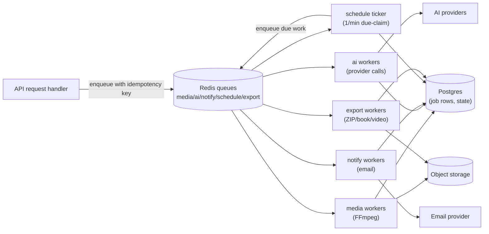
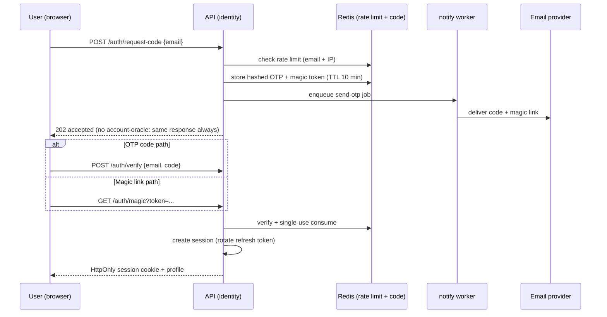
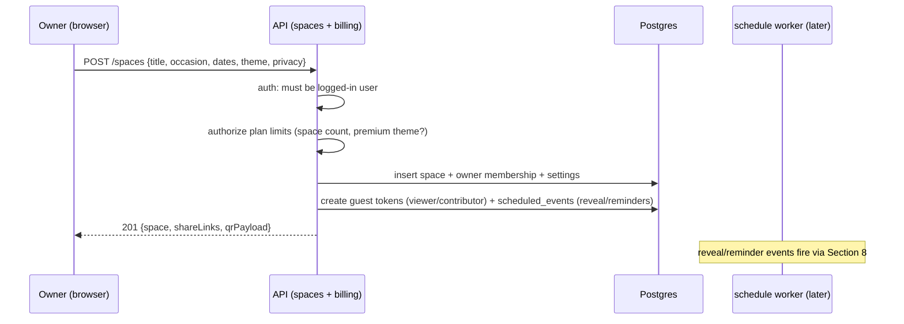
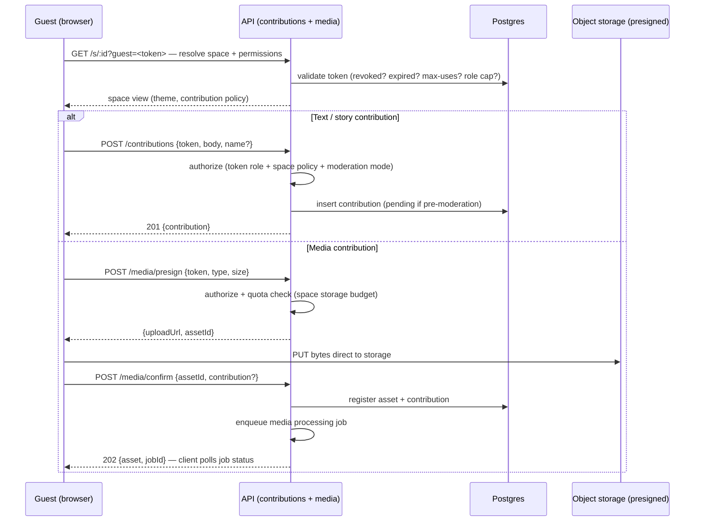
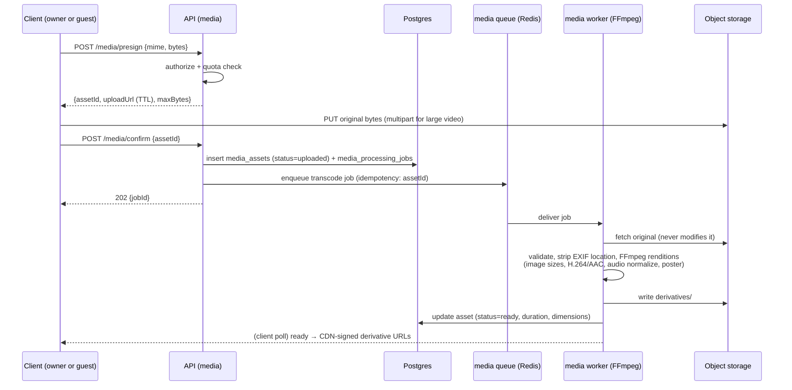

# Memory Lane — Data Flow

Date: 2026-11-17
Stage: Stage 1 — Discovery and System Design, Prompt 03
Companion to [SYSTEM_ARCHITECTURE.md](SYSTEM_ARCHITECTURE.md). Design only —
no application code exists or was changed.

## 1. How the frontend communicates with the backend

- **Protocol:** REST JSON over HTTPS. One typed client (`lib/api.ts`);
  every response uses the shared envelope (data + request id) and the
  shared error shape (code, message, retryable flag). Full request/response
  contracts, validation rules, pagination, and rate limits are specified in
  Prompt 04.
- **Auth on requests:** session cookie (HttpOnly, SameSite=Lax) for
  logged-in owners/collaborators; guest token as `Authorization: Bearer
  <guest-token>` (or cookie) for link/QR access. The API resolves
  *actor = user session OR guest token* on every request, then evaluates
  permissions before touching data.
- **Media bypass:** bytes never flow through the API. The API only mints
  presigned URLs and records metadata; browsers talk directly to
  S3-compatible storage (and the CDN for derivatives).
- **Long operations** (transcode, AI, exports, reveals) are asynchronous:
  the API returns a job id immediately; the client polls job status
  (backoff) and renders progress/empty/error/retry states. Nothing blocks
  a request handler on FFmpeg, AI providers, or email.

## 2. How background jobs are handled



Rules:

1. Handlers validate, authorize, check quotas, write the intent row, and
   enqueue — then return. All heavy lifting happens in workers.
2. Every job carries an idempotency key; retries and double-delivery are
   safe by construction (DB unique constraints + conditional updates).
3. Attempts use exponential backoff; exhausted jobs land in a dead-letter
   row visible to admins with manual retry.
4. The scheduler never runs business logic on a tick: it claims due
   `scheduled_events` rows (`FOR UPDATE SKIP LOCKED`) and enqueues the
   actual work, so restarts and multi-worker deploys stay exactly-once.

## 3. Authentication flow (passwordless)



Notes: identical responses for unknown emails (no account enumeration);
codes are hashed at rest, single-use, and short-lived; sessions rotate
refresh tokens and support logout-everywhere.

## 4. Memory space creation flow



Validation (title, dates, theme entitlement, privacy enum) runs on both
client and server; the server is authoritative.

## 5. Guest contribution flow (no account required)



Abuse controls: per-token and per-IP rate limits, token revocation,
optional pre-moderation queue, size/type allowlists, EXIF location
stripped by default.

## 6. Media upload and processing flow



Failure path: job retries with backoff; terminal failure marks the asset
`failed` with a user-safe reason and owner-visible diagnostics; the
original is retained for manual retry.

## 7. AI processing flow (AI Memory Studio)

```mermaid
sequenceDiagram
    participant O as Owner/Collaborator
    participant A as API (ai-studio + billing)
    participant P as Postgres
    participant Q as ai queue (Redis)
    participant W as ai worker
    participant V as AI provider (via abstraction)

    O->>A: POST /ai/jobs {spaceId, kind, inputs}
    A->>A: authorize (owner/collaborator) + space AI opt-in?
    A->>A: quota check (plan AI budget)
    A->>P: insert ai_generation_jobs (status=queued)
    A->>Q: enqueue (idempotency: jobId)
    A-->>O: 202 {jobId}

    Q->>W: deliver job
    W->>P: load inputs (prefer transcripts/derivatives over originals)
    W->>V: provider call (OpenRouter default; capped prompts)
    V-->>W: result
    W->>W: validate + persist ai_generated_assets<br/>(highlight film: AI edit list → FFmpeg render)
    W->>P: job status=succeeded/failed + usage_records row
    W-->>O: (client poll) preview → accept / regenerate / delete
```

All AI outputs are labeled AI-assisted in the UI; quota is reserved at
enqueue and settled (or refunded on failure) at completion.

## 8. Scheduled reveal flow (reveals, capsules, letters, reminders)

```mermaid
sequenceDiagram
    participant T as schedule ticker (1/min)
    participant P as Postgres (scheduled_events)
    participant Q as queues (Redis)
    participant W as workers (notify/schedule)
    participant U as Recipients

    T->>P: claim due rows (FOR UPDATE SKIP LOCKED, batch)
    P-->>T: due events [{id, kind, run_at, payload, idempotencyKey}]
    T->>Q: enqueue one job per event (key = id + version)
    Q->>W: deliver
    W->>P: mark running → execute (publish space / send letter / digest)
    W->>U: email / in-app notification
    W->>P: mark done (or retryable failure → backoff)
    Note over T: restart catch-up: overdue + unclaimed rows are picked up<br/>on the next tick; already-done keys are never re-run
```

Timezone correctness: `run_at` is stored in UTC with the originating
timezone recorded; reminder date math runs in the space's timezone.

## 9. Export and billing webhooks (summary)

- **Exports** (ZIP, book, video, data export): same async pattern as
  Section 7 — authorize owner, check plan, enqueue on `export` queue,
  build from originals (+ AI assets for books/film), upload result to
  storage, notify with a signed download link. Deletion flows hard-delete
  bytes + rows and write an audit record.
- **Billing webhooks** (Paystack/Stripe): verify signature → idempotent
  handler keyed by provider event id → update `subscriptions`/`payments` →
  enqueue receipt email. Duplicate deliveries are no-ops.
