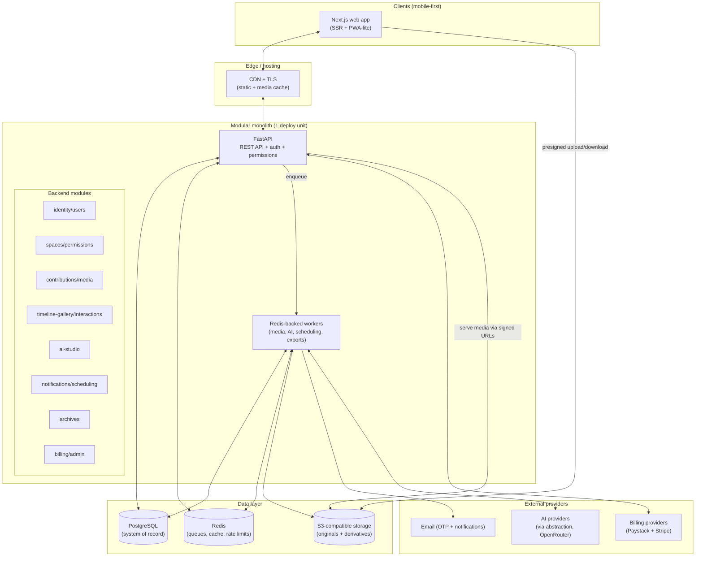
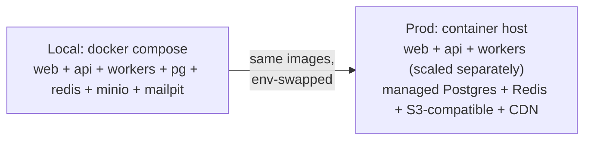

# Memory Lane — System Architecture

Date: 2026-11-17
Stage: Stage 1 — Discovery and System Design, Prompt 03
Status: Design only. No application code exists or was changed.

> Input note: Prompt 02 deliverables (`PRODUCT_REQUIREMENTS.md`,
> `USER_ROLES.md`, `USER_JOURNEYS.md`, `FEATURE_MATRIX.md`) are not present
> in the repo. This design derives from the project brief (8 product modules
> A–H, 6 user roles, product principles, preferred stack) plus the
> [project audit](../PROJECT_AUDIT.md). When Prompt 02 docs are written, they
> must be cross-checked against this design; conflicts go through
> [DECISIONS.md](DECISIONS.md).

## 1. Architectural style: modular monolith

One backend deployment, one frontend deployment, with hard module boundaries
inside the backend. No microservices: the audit found a greenfield repo with
no scaling or team-size pressure that would justify distributed-system cost.



### 1.1 Why this shape

- Single API process + worker processes share one codebase and one database;
  modules communicate via in-process service calls, never HTTP.
- Each module owns its tables, services, and API routes; cross-module access
  goes through the owning module's service layer (enforced by review, and by
  package layout: `backend/modules/<name>/{routes,service,models,schemas}/`).
- Background work (media, AI, scheduling, exports, email) always runs in
  workers, never in request handlers, so mobile uploads and page loads stay
  fast and retries are safe.

## 2. Frontend architecture (Next.js + TypeScript)

- **Framework:** Next.js App Router, TypeScript strict. SSR for public/share
  pages (SEO + fast first paint on low-end devices), client components for
  interactive surfaces (gallery, live wall, uploader).
- **Styling:** Tailwind CSS + shadcn/ui primitives; per-occasion themes
  implemented as CSS-variable theme tokens selectable per space
  (theme id stored on the space, resolved server-side and client-side).
- **Mobile-first:** responsive base, touch-sized targets, bottom-sheet
  contribution flow, resumable/chunked uploads with progress + retry,
  offline-tolerant forms (draft in localStorage, explicit retry states).
- **State/data:** server components fetch via API; client mutations use a
  small typed API client (`lib/api.ts`) with auth header injection, shared
  error/pagination handling, and per-route loading/empty/error states.
- **Auth:** passwordless OTP/magic-link flow; session token in an
  HttpOnly cookie for web. Guest access via URL token (`/s/<space>/g/<token>`)
  stored in-memory/localStorage, sent as a bearer guest credential.
- **Media:** never proxied through the API at runtime. The API mints
  short-lived presigned URLs; the browser uploads/downloads directly to
  S3-compatible storage. Image display uses CDN-cached derivatives.
- **Realtime (live celebration wall):** short-polling first (simple,
  works everywhere); upgrade path to SSE if needed. No websocket
  infrastructure at launch.

Key routes (indicative; contracts in Prompt 04):

```text
/                          marketing + space discovery entry
/login  /verify            passwordless auth
/dashboard                 owner dashboard (spaces, quotas, billing)
/s/[spaceId]               space home (theme-aware)
/s/[spaceId]/contribute    guest contribution flow (token-gated)
/s/[spaceId]/gallery      gallery / timeline / slideshow
/s/[spaceId]/wall          live celebration wall
/s/[spaceId]/studio        AI Memory Studio (owner/collaborator)
/s/[spaceId]/settings      privacy, permissions, scheduling,Danger Zone
/a/[archiveId]             archive download / memory book viewer
```

## 3. Backend architecture (FastAPI modular monolith)

One FastAPI app; one router per module; shared core (`config`, `db`,
`security`, `storage`, `jobs`, `pagination`, `errors`, `rate-limit`).

| Module | Responsibility | Depends on |
|---|---|---|
| identity | passwordless OTP/magic-link, sessions, recovery | users, notifications |
| users | profiles, settings, dashboards | identity |
| spaces | space CRUD, occasion type, themes, publish/reveal dates | permissions, users |
| permissions | roles, policies, enforcement point for every request | users, spaces |
| contributions | text/story/image/video/audio, anonymous + identified, private-to-owner | spaces, permissions, media |
| media | presigned URLs, asset registry, FFmpeg derivatives, originals preservation | storage, jobs |
| timeline-gallery | gallery/timeline/slideshow feeds, search + filters | contributions, media |
| interactions | reactions, replies, moderation queue | contributions, permissions |
| ai-studio | transcription, categorization, captions, summaries, letters, books, highlight film | media, contributions, jobs |
| notifications | email/push templates, delivery | scheduling, users |
| scheduling | reveals, reminders, future letters, capsules, On This Day | spaces, notifications, jobs |
| archives | per-item download, full ZIP, book/video export, data export/deletion | media, ai-studio, jobs |
| billing | plans, quotas, subscriptions, one-time purchases, provider webhooks | users, spaces |
| admin | platform admin views, moderation, usage | all (read-mostly) |

Cross-module rules:

- Writes go through the owning module's service; no direct cross-module
  table writes.
- Every API route declares its permission (`permissions` module evaluates
  owner / collaborator / identified contributor / anonymous guest with token
  / viewer / admin) — authorization is server-side, never UI-only.
- Side effects (email, AI, transcoding, exports) are enqueued jobs with
  idempotency keys, not inline work.

## 4. Database architecture (PostgreSQL)

- **Role:** system of record for everything except bytes (bytes live in
  object storage) and ephemeral state (Redis).
- **Access:** SQLAlchemy 2.x (async) + Alembic migrations; one migration
  chain; every migration reversible in dev, reviewed for production safety
  (expand-migrate-contract for hot tables later).
- **Conventions:** UUIDv7 primary keys, `created_at/updated_at` everywhere,
  soft-delete for user-visible content (hard delete only via privacy/deletion
  flow), foreign keys with explicit delete behavior per entity (Prompt 04).
- **AuthZ in app layer**, not RLS: all queries are issued by one service
  role through the `permissions` module, keeping policy logic in one place
  and testable with Pytest.
- **Scheduling state** (reveals, capsules, reminders) lives in Postgres as a
  due-queue (`scheduled_events` with `run_at`, `status`, idempotency key);
  workers claim due rows with `SELECT … FOR UPDATE SKIP LOCKED`.
- **Backups:** nightly `pg_dump` + provider snapshots (prod); restore drill
  documented before launch. Point-in-time recovery where the host offers it.

## 5. Authentication and authorization

- **Owners/collaborators:** passwordless — email OTP code + magic link
  (both from one request; either verifies). Short-lived access sessions,
  rotating refresh, explicit logout everywhere, account recovery via email
  re-verification. No passwords stored, ever.
- **Guests:** no account required. Share link / QR carries an
  unguessable token (`guest_access_tokens`, per-space, revocable,
  optional expiry + max-uses + role cap: viewer vs contributor).
  Anonymous contributions attach to the token, not a user; identified
  guests may add name/email without creating an account.
- **Permissions matrix** (full version in Prompt 04):

| Capability | Owner | Collaborator | Contributor (known/anon) | Viewer | Admin |
|---|---|---|---|---|---|
| Manage space + privacy | ✓ | limited | — | — | ✓ (support) |
| Invite / revoke tokens | ✓ | ✓ | — | — | — |
| Contribute (per space policy) | ✓ | ✓ | ✓ | — | — |
| React / reply | ✓ | ✓ | ✓ | react-only* | — |
| Moderate (hide/approve) | ✓ | ✓ | own only | — | ✓ |
| Run AI Studio | ✓ | ✓ | — | — | — |
| Export / delete data | ✓ | — | own only | — | — |

\* If the space allows viewer reactions; default off for link-only viewers.

- **Rate limiting** (Redis counters): OTP requests, guest uploads, AI runs,
  and webhook endpoints each have per-IP + per-account/token budgets.

## 6. Media storage and processing

- **Storage:** S3-compatible (MinIO for local dev; managed S3-compatible
  for prod — exact vendor chosen on cost in DECISIONS.md). Two buckets
  (or prefixes): `originals/` (immutable, never modified) and
  `derivatives/` (thumbnails, previews, transcoded video/audio, posters).
- **Upload path:** client requests presigned PUT → uploads bytes direct →
  client confirms to API → API registers `media_assets` row → enqueues
  processing job. Resumable/chunked uploads for large video (S3 multipart).
- **Processing worker:** validates type/size, strips EXIF location (privacy
  default; owner can keep), generates image sizes + video H.264/AAC
  renditions + audio normalization via FFmpeg, extracts duration/dimensions,
  records `media_processing_jobs` status. Originals are never altered.
- **Delivery:** short-lived signed GET URLs minted per authorized request;
  CDN caches derivative URLs. No public buckets.
- **Quotas:** per-space storage quota (free vs premium); checked at
  presign time and enforced at confirm time.

## 7. Background job processing (Redis-backed)

- **Broker + result:** Redis. **Worker lib:** ARQ (asyncio-native, fits
  FastAPI; thin `jobs` wrapper so it can be swapped).
- **Queues:** `media` (transcode), `ai` (generation), `notify` (email),
  `schedule` (reveals/reminders/capsules), `export` (ZIP/book/video).
  Separate concurrency per queue; `export`/`ai` low concurrency (CPU/cost).
- **Reliability:** every job has an idempotency key + max attempts with
  exponential backoff + dead-letter row on exhaustion (visible in admin).
  Scheduler ticks every minute, claims due `scheduled_events` rows, and
  enqueues the real work — wall-clock-safe and retry-safe (no naive cron
  firing business logic directly).
- **Local dev:** Redis + workers run in Docker Compose alongside API/Web.

## 8. AI integration architecture

- **Provider abstraction:** `ai-studio` calls an internal `AIProvider`
  interface (text, vision, transcription, TTS candidates); OpenRouter is
  the default route for text/vision, swappable per deployment. Keys live in
  env, never in code or logs.
- **All AI runs are jobs:** transcription, categorization, caption
  suggestions, summaries, memory letters, memory books, highlight-film
  assembly (FFmpeg cutter driven by an AI edit list — the model picks
  moments, FFmpeg renders deterministically).
- **Guardrails:** per-space AI opt-in, per-plan AI quotas (checked before
  enqueue), prompt/output size caps, no original bytes sent unless required
  (prefer derivatives/transcripts), retention policy for provider-side data
  documented in privacy copy.
- **Outputs** are first-class rows (`ai_generation_jobs`,
  `ai_generated_assets`) linked to the space, previewable, regenerable,
  deletable — and always labeled as AI-assisted in the UI.

## 9. Notifications and scheduling

- **Notifications:** template-based email via a transactional provider
  (SMTP-compatible interface; vendor by cost/deliverability in Nigeria +
  global). Queued in `notify`; preferences per user (reminders on/off).
- **Scheduling:** timezone-aware `scheduled_events` (`reveal`, `reminder`,
  `future_letter`, `capsule`, `on_this_day_digest`) created by space
  settings; the `schedule` worker executes them exactly once (idempotency
  key = event id + version). Missed-tick catch-up on worker restart.
- **Reminders:** birthday/anniversary engine derives dates from spaces the
  user owns/follows; digests batched per user per day.

## 10. Billing architecture

- **Model:** free + premium plans, storage quotas, AI quotas, premium
  themes, one-time purchases (single-space boost, extra export), future
  print — entitlements resolved by `billing` (`subscriptions`, `payments`,
  `usage_records`) and enforced at the same checkpoints as permissions
  (presign, AI enqueue, theme select, export).
- **Providers:** Paystack (Nigeria/Africa coverage: cards, bank transfer,
  mobile money) + Stripe (international cards); both behind a small
  `BillingProvider` interface. Webhooks verified by signature, processed
  idempotently through the `notify`/worker path.
- **Dunning/grace:** past-due keeps read access, blocks new uploads/AI
  after a grace window; downgrade never deletes memories (blocks new
  premium usage only).

## 11. Monitoring, logging, backup, recovery

- **Logging:** structured JSON logs (request id propagated API → worker);
  no PII/secrets/tokens in logs.
- **Monitoring:** health endpoints (`/healthz`, `/readyz`), worker queue
  depth + dead-letter alerts, job duration/error-rate dashboards, storage
  quota gauges. Provider: cheapest credible option at deploy time
  (host-native metrics + Sentry-style errors); no self-hosted Prometheus
  at launch unless the host lacks basics.
- **Backup/recovery:** Postgres dumps + snapshots; object-storage versioning
  for `originals/`; Redis is disposable (jobs rebuildable from DB rows).
  RTO/RPO targets declared in runbook before launch; restore drill once.

## 12. Deployment architecture



- **Local:** Docker Compose runs everything (web, api, workers, Postgres,
  Redis, MinIO, Mailpit for email preview).
- **Prod:** container-compatible host (single host or PaaS to start;
  scale API and workers independently). Managed Postgres/Redis where
  affordable; otherwise the same Compose topology on one VM with backups.
- **Config:** 12-factor env vars; `.env.example` kept accurate; strict
  startup validation (fail fast on missing secrets).
- **CI:** lint + typecheck + Pytest + Vitest on every change; Playwright
  on the critical journeys (auth, space create, guest contribute, reveal);
  image build + Compose smoke test before deploy. No auto-deploy to
  production without approval.

## 13. Module communication summary

| From → To | Mechanism |
|---|---|
| Browser → API | REST JSON over HTTPS, cookie/bearer auth |
| Browser → Storage | Presigned S3 URLs (direct, no API proxy) |
| API → Workers | Redis queues (ARQ), idempotency keys |
| Workers → DB/Storage/AI/Email | Direct, with retries + dead-letter |
| Scheduler → Workers | DB due-queue claim, then enqueue |
| Billing providers → API | Signed webhooks → idempotent handlers |

Detailed flows (auth, space creation, guest contribution, media, AI,
scheduled reveal) live in [DATA_FLOW.md](DATA_FLOW.md). Rationale for the
choices above lives in [DECISIONS.md](DECISIONS.md).
